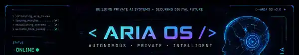
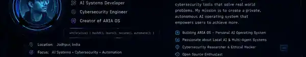
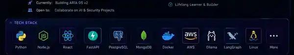
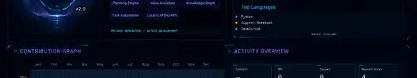
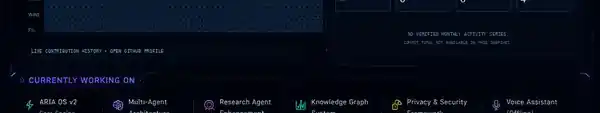

   
   
   
   
   
   
   
  

## Featured repositories

- [**ThreatVision AI**](https://github.com/songarapankaj1304-cmd/ThreatVision-AI) — AI-driven intrusion detection and cyber threat analysis using machine-learning workflows and network-traffic datasets.
- [**Real-Time Malware Detection — Splunk + YARA**](https://github.com/songarapankaj1304-cmd/Real-Time-Malware-Detection-Splunk-YARA) — Malware detection framework integrating YARA rules with Splunk log monitoring and analysis.
- [**Self-Destructing Chat Room**](https://github.com/songarapankaj1304-cmd/Self-Destructing-Chat-Room) — Privacy-focused real-time chat prototype with ephemeral, memory-only messages.
- **ARIA OS** — Private AI operating-system project in active development.

## About

**Founder • AI Systems Engineer • Cybersecurity Engineer**

I build intelligent software at the intersection of artificial intelligence, cybersecurity, and automation — creating technology that is secure, private, and built for the future.

Currently building **ARIA OS** while exploring autonomous AI systems, local LLMs, and the future of intelligent computing.

## Engineering toolkit

**AI:** AI Systems Engineering · AI Agents · Local LLMs · Prompt Engineering · AI Automation

**Cybersecurity:** Web Application Security · Penetration Testing · OWASP Top 10 · Burp Suite · Nmap · Wireshark · Metasploit · Splunk · YARA

**Development:** Python · Node.js · Express.js · FastAPI · React · Vite · JavaScript

**Data & Infrastructure:** PostgreSQL · MongoDB · SQLite · AWS · Docker · Linux · Git

## Connect

[LinkedIn](https://www.linkedin.com/in/pankaj-songara-a19284291/) · [GitHub](https://github.com/songarapankaj1304-cmd) · [Email](mailto:songarapankaj1304@gmail.com)

---

*Profile visual snapshot: 26 November 2026. The image shows verified public-profile figures only. Private repository data, unsupported commit totals and unverified contribution history are not represented as facts.*
